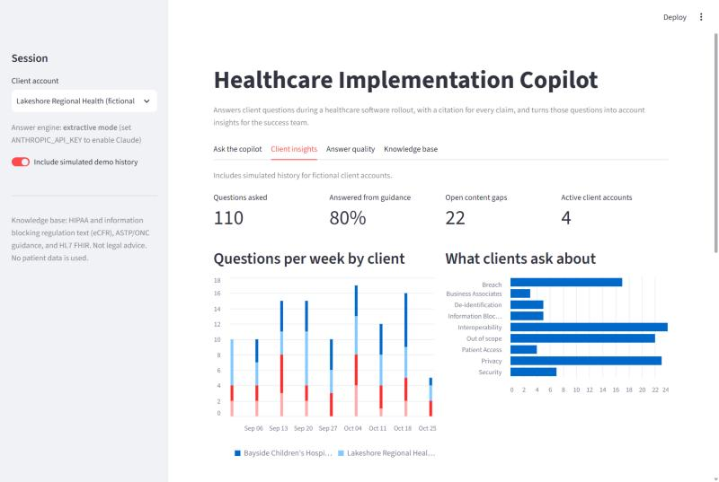

# Healthcare Implementation Copilot

A retrieval-augmented (RAG) assistant that answers the compliance and interoperability
questions hospital clients raise during a healthcare software rollout. Every answer
cites the exact passage of public federal guidance it came from. Every question is also
logged to a **client success dashboard**, which shows what each account asks about,
where the documentation falls short, and which accounts need attention.

Built by Evan Stolba as a portfolio project for technical customer success roles in healthcare.



## What it does

| Area | What's included |
|---|---|
| **Knowledge base** | 11 public sources (147 passages): the HIPAA regulation text itself (45 CFR 160.103 definitions; 164.502-.514 uses, disclosures, minimum necessary and de-identification; 164.524 right of access; business associate contracts; Security Rule safeguards; Breach Notification), the information blocking rule (45 CFR 171), ASTP/ONC's information blocking page, and the HL7 FHIR overview, pulled from the official eCFR API |
| **Retrieval** | Section-aware chunking with overlap, BM25 keyword search, and a small map that translates everyday words into regulatory terms ("patient" to "individual", "vendor" to "business associate") |
| **Answers** | Claude (`claude-opus-5-5`) using the API's native **citations**, so each claim links to its source passage |
| **Safety** | Declines out-of-scope questions in two layers: a retrieval-confidence check (BM25 score plus how much of the question the passages actually cover), then the model reporting when the documents don't cover the question. It never answers from general knowledge |
| **Evaluation** | 25-question test set, including 5 out-of-scope "trap" questions. Measures retrieval hit@5, answer rate, correct abstention, fact coverage and citation accuracy |
| **Success dashboard** | Questions per week by client, topic mix, account health table, and a ranked list of **content gaps** (questions the copilot couldn't answer) |

## Results

Retrieval-only evaluation (no API calls), 25 questions:

| Metric | Result |
|---|---|
| Right source ranked #1 (hit@1) | **95%** (19/20), up from 80% before the vocabulary map |
| Right source in top 5 (hit@5) | **100%** (20/20) |
| In-scope questions answered | **100%** (20/20) |
| Off-topic questions declined by the retrieval check alone | **80%** (4/5), up from 20% with a score-only cutoff. The remaining one goes on to the model, which is instructed to decline |

### What the evaluation caught

1. **HHS blocks automated downloads**, so the first version of the knowledge base silently lost 7 of 10 sources.
   The fix was to switch to the official eCFR API and use the regulation text itself, which is also the more authoritative source.
2. **A score-only confidence cutoff couldn't separate off-topic questions.** "How much does an Epic license cost for a 300-bed hospital?" scored higher than real questions, because "hospital" and "cost" appear in the regulations. Adding a coverage check (does the passage contain the question's *distinctive* words?) raised correct declines from 1/5 to 4/5 without losing any in-scope answers.
3. **Clients and regulations use different words.** Clients ask about "patients"; the rules say "individuals". Everyday questions drifted to the FHIR pages, which use everyday language. A small vocabulary map fixed 3 of the 4 top-1 misses.

## Quick start

```bash
python -m venv .venv
.venv\Scripts\activate          # macOS/Linux: source .venv/bin/activate
pip install -r requirements.txt

python -m copilot.ingest          # fetch and chunk the public sources
python -m scripts.seed_demo_log   # optional: simulated history for 4 fictional client accounts
python -m evals.run_evals --retrieval   # free retrieval-only evaluation

streamlit run app.py
```

To turn on Claude-generated answers, set an API key before running:

```bash
set ANTHROPIC_API_KEY=your-key-here     # macOS/Linux: export ANTHROPIC_API_KEY=...
python -m evals.run_evals               # full evaluation (costs a few cents)
```

Without a key the app still runs in **extractive mode**, showing the best-matching passages.

## Project layout

```
copilot/
  sources.py        the public sources in the knowledge base
  ingest.py         fetch, clean, and chunk pages into data/chunks.jsonl
  retrieval.py      BM25 index
  answer.py         grounded answers with Claude citations, abstention logic
  question_log.py   append-only log that feeds the dashboard
evals/
  questions.jsonl   test set (20 in scope + 5 out of scope)
  run_evals.py      metrics runner -> evals/results/
scripts/
  seed_demo_log.py  simulated history for fictional clients (flagged demo=True)
app.py              Streamlit app: Ask / Client insights / Answer quality / Knowledge base
```

## Design choices

- **BM25 instead of embeddings.** Regulatory text depends on exact terms like "business
  associate", "minimum necessary" and "unsecured PHI". BM25 handles these well, has no
  extra service or cost, and makes each match explainable. Hybrid search is the next step (below).
- **Native citations instead of asking the model to write "[1]".** Citations come back
  as structured data tied to the passage, so they can't be invented.
- **Abstaining is a feature.** In healthcare, a confident wrong answer costs more than
  "I don't know, here's who to ask". Unanswered questions are logged as content gaps, which
  is how a success team finds missing documentation and training needs.
- **No patient data.** All sources are public government publications or the HL7 FHIR
  specification (CC0). The dashboard's client accounts are fictional; their simulated
  out-of-scope questions are recorded as unanswered, as full mode would record them.

## Limitations and next steps

- The confidence thresholds and vocabulary map were tuned on this same 25-question set, so the
  numbers above are optimistic. A larger held-out question set is the next step.
- Fact coverage is scored with keyword groups. Next step: an LLM-as-judge with a rubric,
  validated against human labels.
- `pandas` is pinned to 2.2.3 because Windows Smart App Control blocks newer, not-yet-reputable binaries.
- Add hybrid retrieval (BM25 + embeddings) and a reranker; compare hit@5 before and after.
- Add CMS interoperability rules and the client's own product documentation.
- This is not legal advice. Specific determinations belong with a compliance team.
